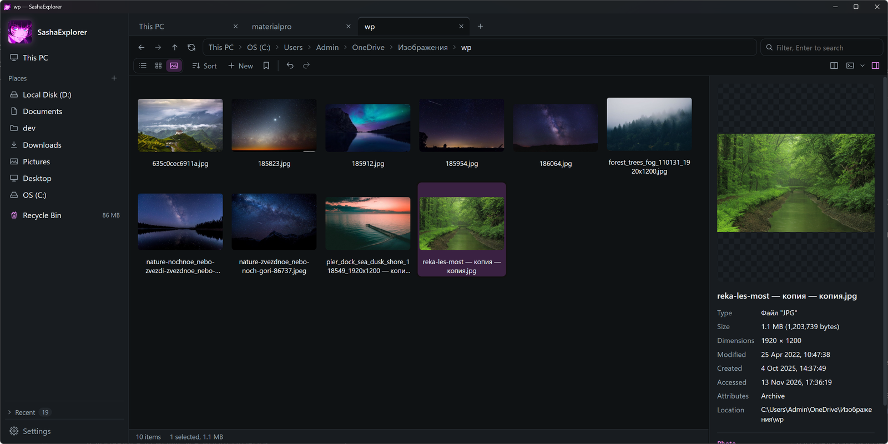
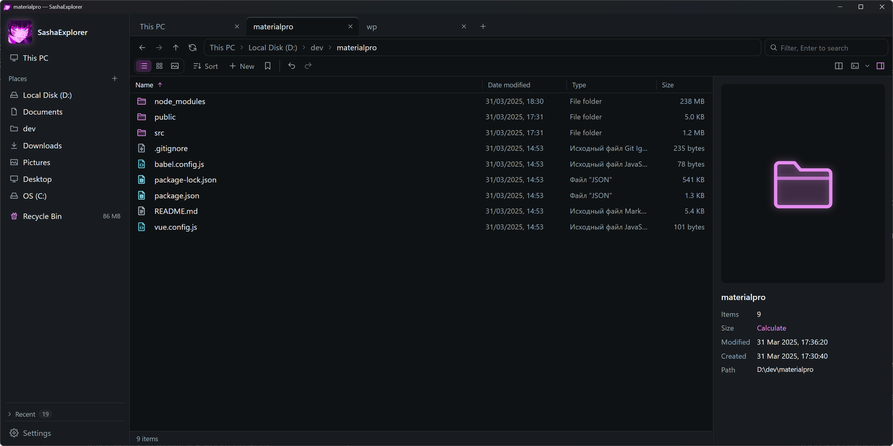
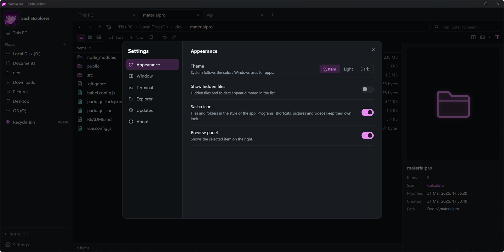

# SashaExplorer

A file manager for Windows, made for fans of **Cyberpunk: Edgerunners**: neon
pink on dark, tabs, split panes, a gallery, and a preview panel. It is one
portable executable: no installer, and its data stays next to it.

[](https://github.com/yanbess/SashaExplorer/releases/latest)
[](LICENSE)







## Features

- **Tabs and split panes.** Tabs come back with their pins when the program
  opens again. Drag a tab to the side, or press Ctrl+\\, to see two folders at
  once. A folder that is already open in a tab is shown there instead of
  opening twice.
- **Three views per folder:** details, icons, and a gallery whose size follows
  Ctrl+wheel. Each folder keeps its own view and sort order.
- **Preview panel** for images, videos and audio with playback, text files, and
  details: camera settings of photos, and the streams, codecs and tags of
  videos and songs.
- **Windows inside:** thumbnails, icons, the context menu, copy and move with
  the Windows progress and conflict dialogs, the Recycle Bin, and a clipboard
  shared with Explorer. Items drag to and from any other program.
- **Undo and redo** for renames, new items, moves, copies, and deletions.
- **Search** in subfolders, with `*` and `?`.
- **Terminals:** open the folder in PowerShell, PowerShell 7, Command Prompt,
  Git Bash, a WSL distribution, Windows Terminal, LucyShell, or a terminal of
  your own. Choose the default in Settings.
- **Light and dark themes**, or the one Windows uses.
- **Explorer integration**, optional: "Open in SashaExplorer" in the Explorer
  menu, or SashaExplorer as the program for folders and Win+E.
- **Private by default:** the list of tabs and folders is encrypted for the
  current Windows user. The only network request is an optional daily check
  for a new release on GitHub.

## Install

1. Download `SashaExplorer-<version>-windows-amd64.zip` from the
   [latest release](https://github.com/yanbess/SashaExplorer/releases/latest)
   and check it against the `.sha256` file next to it if you like.
2. Unpack `SashaExplorer.exe` into a folder of its own, such as
   `%LOCALAPPDATA%\Programs\SashaExplorer`.
3. Run it. Windows 10 1809 or later is needed, with the Microsoft WebView2
   Runtime, which comes with Windows 11.

The program is not signed yet, so Windows SmartScreen may warn on the first
start: choose **More info**, then **Run anyway**.

To update, replace the executable. SashaExplorer says when a new version is
out; it does not install anything by itself.

## Documentation

- [Using SashaExplorer](docs/usage.md): the window, keyboard and mouse, settings.
- [Building from source](docs/building.md)
- [Releasing](docs/releasing.md): how versions and releases are made.
- [Changelog](CHANGELOG.md)
- [Contributing](CONTRIBUTING.md)

## Quick build

```
go install github.com/wailsapp/wails/v2/cmd/wails@v2.17.1
wails build -trimpath
```

The program is at `build/bin/SashaExplorer.exe`. See
[docs/building.md](docs/building.md) for the details.

## Fan project

SashaExplorer is an unofficial fan project. It is not affiliated with, endorsed
by, or connected to CD PROJEKT RED or Studio Trigger. Cyberpunk and
Cyberpunk: Edgerunners are trademarks of their owners.

## License

[MIT](LICENSE)
